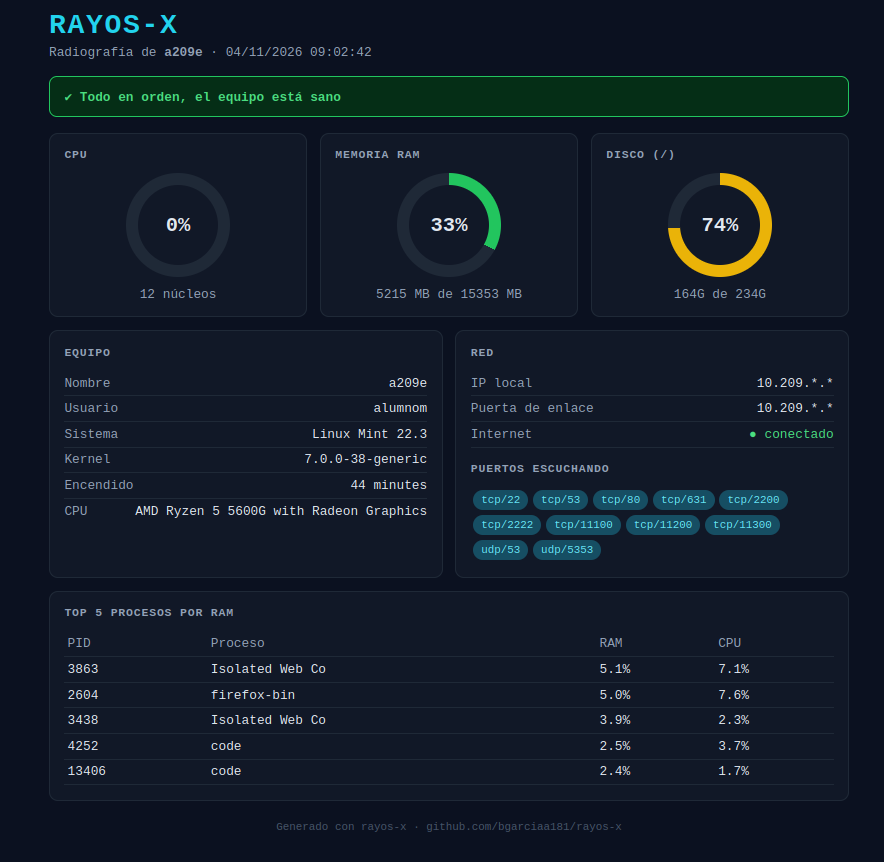

# rayos-x 🩻

Script en Bash que hace una "radiografía" rápida de un equipo Linux y te enseña cómo está de salud: en la terminal, en una página web o en vivo.

Lo hice porque en soporte muchas veces necesito revisar un equipo rápido y no quiero ir lanzando comandos uno a uno.



## Qué muestra

- Datos del equipo: nombre, usuario, sistema, kernel y tiempo encendido
- Uso de CPU, RAM y disco con colores tipo semáforo:
  - 🟢 verde: menos del 70%
  - 🟡 amarillo: entre 70% y 90%
  - 🔴 rojo: más del 90%
- Red: IP local, puerta de enlace y si hay Internet
- Puertos que están escuchando
- Los 5 procesos que más RAM gastan
- Usuarios conectados
- Un resumen con avisos si algo va mal

## Cómo usarlo

```bash
git clone https://github.com/bgarciaa181/rayos-x.git
cd rayos-x
chmod +x rayos-x.sh
./rayos-x.sh
```

### Opciones

| Opción | Qué hace |
|--------|----------|
| (nada) | Muestra el informe en la terminal |
| `-w`   | Genera un informe en HTML tipo panel de control |
| `-l`   | Modo en vivo: CPU, RAM y disco actualizándose cada segundo |
| `-g`   | Muestra el informe y lo guarda en un `.txt` |
| `-h`   | Muestra la ayuda |

### Informe en HTML

```bash
./rayos-x.sh -w
xdg-open informe_*.html
```

Crea un archivo `informe_NOMBREEQUIPO_FECHA.html` que se abre en el navegador. No necesita Internet ni instalar nada, así que se puede pasar a otra persona o adjuntar en una incidencia.

### Modo en vivo

```bash
./rayos-x.sh -l
```

Las barras se van actualizando cada segundo junto con los procesos que más CPU gastan. Para salir, `Ctrl+C`.

## Requisitos

- Linux (probado en Ubuntu y Debian)
- Bash
- Comandos normales del sistema: `free`, `df`, `ps`, `ip`, `ss`, `ping`

## Autora

Bea García · [@bgarciaa181](https://github.com/bgarciaa181)
